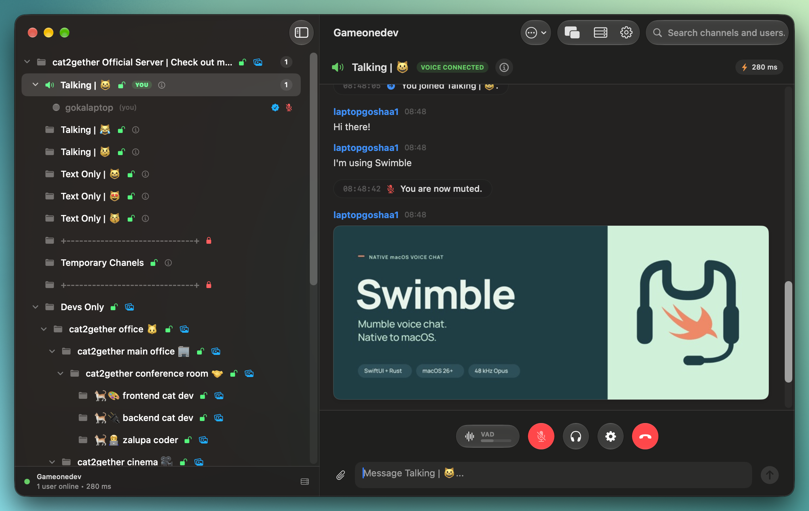
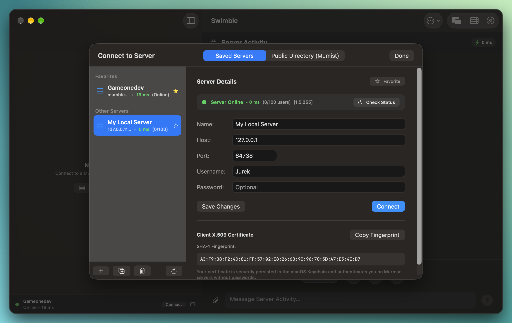
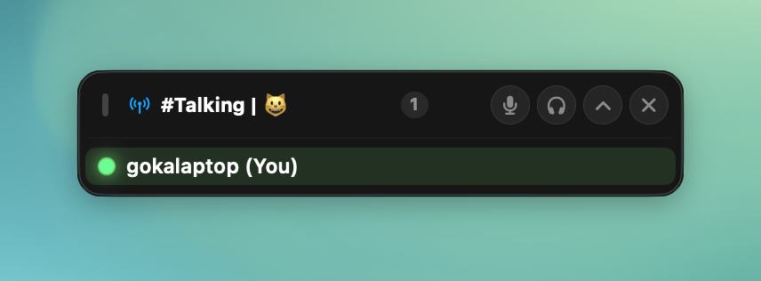
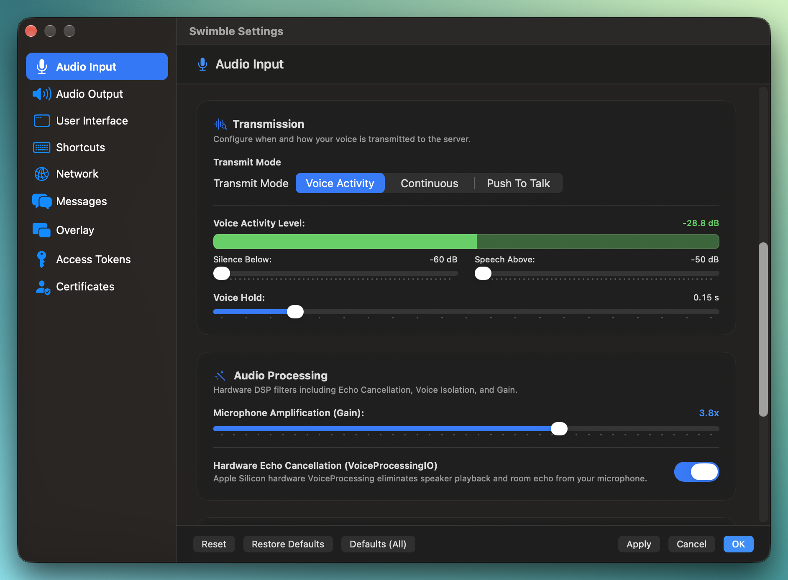
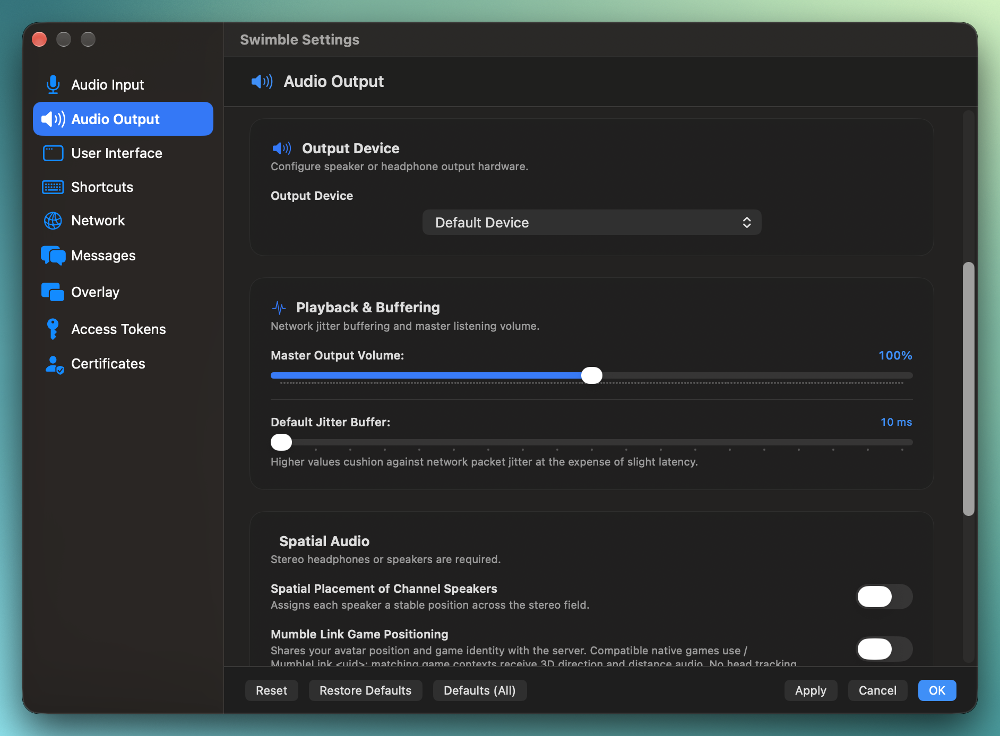
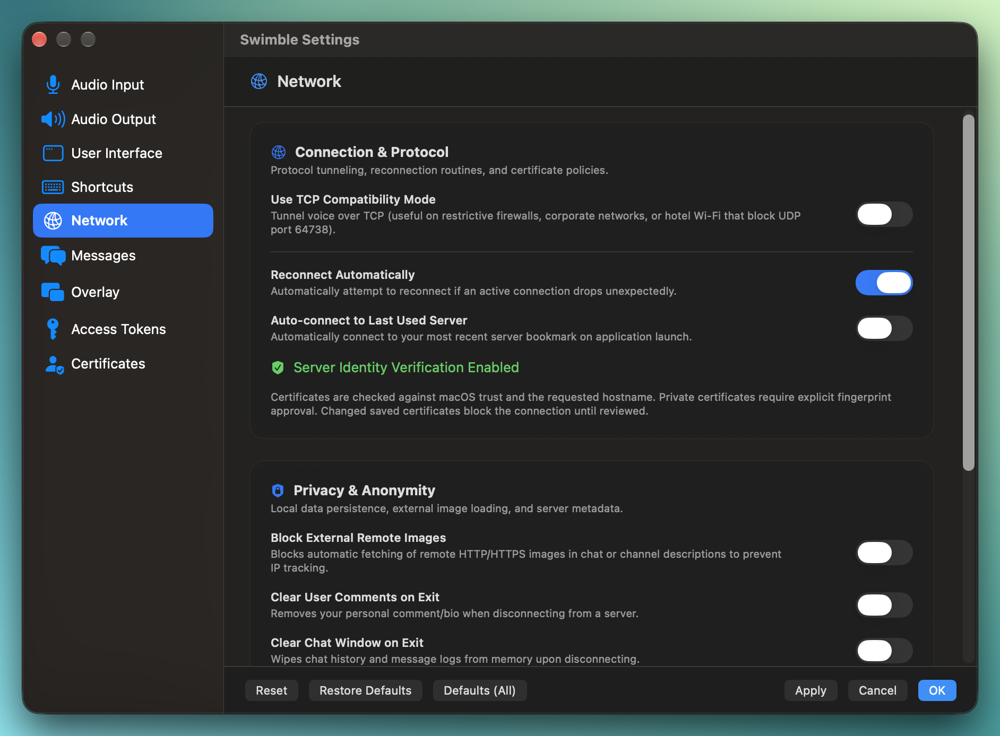

# Swimble Media & Gallery

[← Back to README](README.md)

Screenshots and video previews showcasing **Swimble** — the native macOS Mumble client engineered with macOS Liquid Glass and a high-performance Rust core.

---

## Navigation

- [Video Preview](#video-preview)
- [Main Interface](#main-interface)
- [Server Browser & Selection](#server-browser--selection)
- [Floating Voice Overlay](#floating-voice-overlay)
- [Audio Input Settings](#audio-input-settings)
- [Audio Output Settings](#audio-output-settings)
- [Network & Security Settings](#network--security-settings)

---

## Video Preview

A 30-second walkthrough highlighting Swimble's native macOS interface, Liquid Glass controls, low-latency voice handling, and settings.

<video src="media/promo-video.mp4" controls width="100%">
  
Your browser does not support embedded HTML5 video. You can <a href="media/promo-video.mp4">view or download the promo video directly</a>.

</video>

> 🎬 **[Open / Download Promo Video (`promo-video.mp4`)](media/promo-video.mp4)**

---

## Main Interface

The primary application window features a native macOS navigation split view with Liquid Glass styling, hierarchical channel navigation, active speaker indicators, integrated text chat, and floating voice controls (Mute, Deafen, Push-to-Talk, Disconnect).

---

## Server Browser & Selection

Server connection manager supporting saved bookmarks, local network discovery, and public server browsing (Mumist and Mumble.info directories) with ping and latency monitoring.

---

## Floating Voice Overlay

A minimal, unobtrusive floating overlay displaying active speakers in real time, suitable for full-screen games and multi-monitor workflows.

---

## Audio Input Settings

Hardware configuration for microphone selection, transmission modes (Push-to-Talk, Voice Activity, Continuous), live input preview meter, speech threshold, Opus encoder bitrate, and packet duration.

---

## Audio Output Settings

Playback settings including output device routing, master volume, receive jitter buffer, positional audio controls, Apple `VoiceProcessingIO` hardware echo cancellation, and speech-driven system ducking.

---

## Network & Security Settings

Connection preferences for standard Mumble TCP/UDP transport, forced TCP mode, TLS certificate validation, private-server fingerprint trust, and Keychain integration.

---

[← Back to README](README.md)
