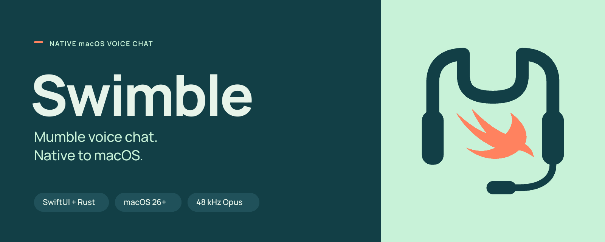

<p align="center">
  
</p>

**Swimble** is a native macOS voice chat client for Mumble servers. It combines a SwiftUI interface with a Rust core for the Mumble protocol, audio codecs, and connection state.

The project targets standard Mumble 1.5 and 1.6 servers, commonly known as Murmur. It uses the existing Mumble protocol and does not require server extensions.

[Download](https://github.com/jurek-zsl/Swimble/releases/latest) · [Release history](https://github.com/jurek-zsl/Swimble/releases) · [Build from source](#build-from-source) · [Report an issue](https://github.com/jurek-zsl/Swimble/issues)

## Requirements and installation

Published builds require an **Apple Silicon Mac running macOS 26 or later**. The DMG includes the Opus audio library; Homebrew is not required to run the application.

1. Download the DMG from the [latest release](https://github.com/jurek-zsl/Swimble/releases/latest).
2. Open the disk image and drag **Swimble** into **Applications**.
3. Launch Swimble from Applications and allow microphone access when prompted.
4. Open **Server → Connect**, then add a server or choose one from the public directory.

Global push-to-talk and other system-wide shortcuts require Accessibility permission. Audio devices, transmission mode, and key bindings can be configured in Settings.

Current release builds are ad hoc signed and are not Apple-notarized. Each release includes a SHA-256 checksum for the DMG.

## Features

| Area | Capabilities |
| --- | --- |
| Voice | 48 kHz mono Opus audio; push-to-talk, voice activity, and continuous transmission; mute, deafen, whisper, and per-user volume controls. |
| Servers | Saved connections, public server browsing, DNS SRV lookup, `mumble://` links, connection diagnostics, and TCP voice tunneling. |
| Channels and messaging | Channel navigation, participant lists, text chat, formatted channel descriptions, user comments, and moderation actions subject to server permissions. |
| Audio controls | Input and output device selection, microphone monitoring, echo cancellation through AVAudioEngine voice processing, and local WAV recording. |
| macOS integration | SwiftUI Liquid Glass interface, menu bar controls, global shortcuts, a floating speaker overlay, and Keychain storage for credentials and client identities. |
| Client identities | Certificate generation and PKCS#12 import and export. |

Public server browsing uses Mumist.eu, with a fallback to the Mumble.info directory. Live activity data depends on the directory source and is not available in the fallback list-only mode.

## Compatibility and limitations

- Standard Mumble connections use TCP/TLS for control traffic and UDP for voice, on port `64738` by default. Voice can be tunneled over TCP when UDP is unavailable.
- The implementation targets Mumble 1.5 and 1.6; feature availability also depends on server configuration and permissions.
- **Server identity verification is currently disabled.** The [TLS connection implementation](rust-core/src/connection.rs) accepts server certificates and handshake signatures without validation. TLS transport does not establish a verified server identity in the current implementation.
- Published binaries are for Apple Silicon. Intel builds are not provided.

## Architecture

The application separates Mumble protocol handling from the macOS interface and audio hardware integration.

| Component | Responsibility |
| --- | --- |
| [`rust-core/`](rust-core/) | Mumble TCP/TLS and UDP transport, Protobuf messages, OCB2-AES128 packet encryption, Opus encoding and decoding, audio mixing, receive buffering, DNS SRV resolution, and client certificate operations. |
| [`MacClient/`](MacClient/) | SwiftUI views and application state, AVAudioEngine input and output, CoreAudio device selection, global shortcuts, Keychain integration, and macOS notifications. |
| UniFFI and `rtrb` | Generated Rust–Swift bindings for commands and events, with ring buffers for PCM audio exchange. |

The protocol definition is kept in [`rust-core/proto/Mumble.proto`](rust-core/proto/Mumble.proto). Generated Swift bindings and the Rust static library are consumed by the Xcode target.

## Build from source

### Prerequisites

- An Apple Silicon Mac running macOS 26 or later.
- Xcode with the macOS 26 SDK or later and its command line tools. Select this Xcode installation as the active developer directory.
- Rust and Cargo, installed through [rustup](https://rustup.rs/).
- Homebrew packages for Opus, XcodeGen, and the Protocol Buffers compiler:

  ```sh
  brew install opus xcodegen protobuf
  ```

The current release was built with Xcode 27.0 and Rust 1.92.0. The repository does not declare a minimum supported Rust version.

### Development build

Clone the repository and build the Rust library and Swift bindings:

```sh
git clone https://github.com/jurek-zsl/Swimble.git
cd Swimble
MACOSX_DEPLOYMENT_TARGET=26.0 ./scripts/build_bridge.sh
```

The bridge script compiles the Rust core, generates the UniFFI bindings, copies the static library into `MacClient/Generated/`, and runs XcodeGen.

Build and launch the application:

```sh
xcodebuild -project MacClient/Swimble.xcodeproj \
  -scheme Swimble \
  -destination 'platform=macOS' \
  -configuration Debug \
  -derivedDataPath build/development build

open build/development/Build/Products/Debug/Swimble.app
```

Development builds link against the local Homebrew Opus library. Use the release workflow below to produce a distributable application with Opus included.

[`MacClient/project.yml`](MacClient/project.yml) is the source of truth for the Xcode project. Edit that file rather than `project.pbxproj`, then regenerate the project:

```sh
(cd MacClient && xcodegen generate)
```

### Release packaging

The release workflow also requires Python 3 with `venv` and `pip`. It downloads and verifies the pinned Opus source archive and installs the packaging dependencies into a local virtual environment.

```sh
./scripts/build_release.sh
```

The script produces `build/Swimble-<version>.dmg` and its `.dmg.sha256` file. It builds Opus for macOS 26, embeds the library and its license, signs the staged application, and saves the installer background and icon positions. The final read-only image is remounted to verify its contents and Finder metadata.

See [`scripts/RELEASING.md`](scripts/RELEASING.md) for versioning and packaging details.

## Testing

The Rust test suite covers packet serialization, cryptographic packet handling, certificate import and export, state updates, DNS resolution, and live server connections.

The local integration tests expect a Murmur server at `127.0.0.1:64738`. If the `murmur-test` container already exists, start it with `docker start murmur-test`. Otherwise, create it with:

```sh
docker run --detach --name murmur-test \
  --publish 127.0.0.1:64738:64738/tcp \
  --publish 127.0.0.1:64738:64738/udp \
  mumblevoip/mumble-server:latest
```

Run the suite from the repository root:

```sh
cd rust-core
cargo test
```

The full suite also includes DNS lookups and a public-server ping test, so it requires network access. To run only the local server integration checks:

```sh
cargo test --test murmur_integration test_murmur_live_integration
cargo test --test murmur_integration test_ping_mumble_server_udp_and_tcp
```

## Contributing

Bug reports and focused pull requests are welcome. For connection or audio issues, include the Swimble version, macOS version, server version, audio device details where relevant, reproduction steps, and logs.

Keep Mumble protocol and codec changes in `rust-core/`, and macOS interface and hardware integration changes in `MacClient/`. Regenerate the UniFFI bindings when changing exported Rust types or commands. Protocol changes should include integration coverage against the local Murmur server.

## License

Swimble is licensed under the [MIT License](LICENSE). Bundled third-party components retain their own licenses; the release application includes the Opus license.

Swimble is an independent client and is not affiliated with the Mumble project. Mumble and Murmur are trademarks of their respective owners.
