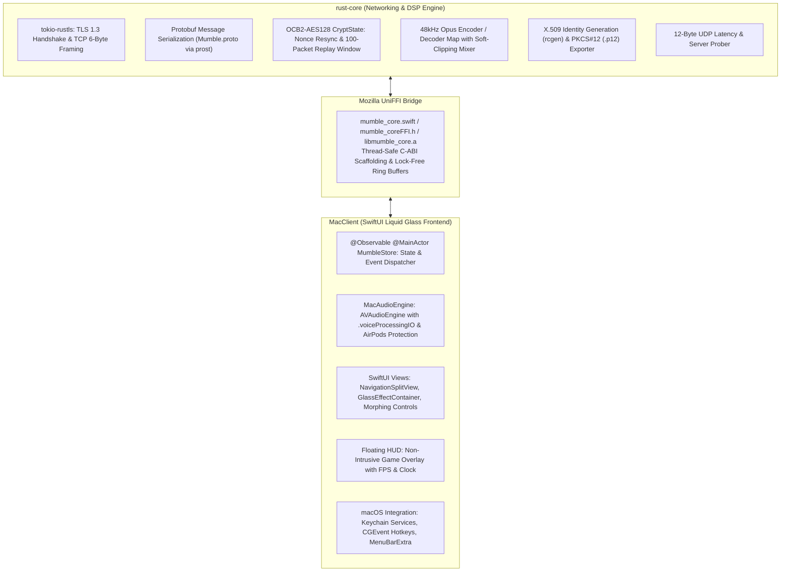

# Swimble

<p align="center">
  
</p>

<p align="center">
  <strong>The Next-Generation Native macOS Mumble VoIP Client</strong><br/>
  Engineered with <strong>macOS 26 Liquid Glass SwiftUI</strong> and a high-performance <strong>Rust Core</strong>.
</p>

<p align="center">
  
  
  
  
  
  
  
</p>

---

## Overview

Swimble is a native macOS client engineered specifically for standard **Mumble (`Murmur`)** VoIP servers (TCP/TLS and UDP port 64738).

Rather than wrapping legacy Qt/C++ codebases, Swimble implements a dual-layer architecture built natively for Apple Silicon and macOS 26:
- **Zero Legacy Frameworks**: Built from scratch using native SwiftUI conforming to the macOS 26 Liquid Glass design language.
- **Memory-Safe Rust Engine**: All cryptographic networking, Protobuf framing, UDP OCB2-AES128 encryption, Opus encoding/decoding, and per-user jitter buffering execute in an isolated, multi-threaded Rust core.
- **Hardware-Accelerated Audio**: Direct integration with Apple `AVAudioEngine` utilizing `.voiceProcessingIO` for hardware acoustic echo cancellation (AEC), automatic gain control, and low-latency rendering.
- **Full Murmur Compatibility**: Implements standard Mumble 1.5 and 1.6 protocols without requiring server modifications or proprietary extensions.

---

## Architectural Boundary

Swimble enforces a strict separation between low-level networking DSP and the high-level user interface:



### Layer Responsibilities

| Subsystem | Location | Primary Responsibilities |
| :--- | :--- | :--- |
| **Rust Core** | `rust-core/` | TCP framing (6-byte header), TLS 1.3 session management, Protobuf encoding/decoding, UDP OCB2-AES128 packet encryption, Opus audio encoding/decoding (48kHz mono), per-user jitter buffers, automatic UDP-to-TCP tunnel fallback, X.509 certificate generation via `rcgen`, and PKCS#12 import/export. |
| **UniFFI Bridge** | Mozilla `uniffi` | Generates safe, high-speed C-ABI foreign function interface bindings and Swift bridging code via `uniffi::setup_scaffolding!()`. |
| **Swift Frontend** | `MacClient/` | Native macOS 26 SwiftUI interface, `AVAudioEngine` hardware I/O, live CoreAudio device switching, global `CGEvent` hotkey taps, Apple Keychain certificate/password persistence, and HUD rendering. |

---

## Feature Matrix

### 1. macOS 26 Liquid Glass User Interface
- **Morphing Voice Control HUD**: Floating voice controls wrapped in `GlassEffectContainer` using `.glassEffect(.regular.tint(...).interactive(), in: .capsule)` with spring morph animations across Mute, Deafen, Push-to-Talk, and Disconnect.
- **Dynamic Speaking Indicators**: Real-time visual feedback indicating voice state:
  - Normal channel audio
  - Targeted whispers (cyan glow)
  - Channel tree shouts (orange glow)
- **Accent Personalization**: Selectable Liquid Glass accent colors (Cyan, Emerald, Sapphire, Amethyst, Amber, Ruby) applied across buttons, selections, and background glows.
- **Menu Bar Extra**: Lightweight menu bar icon displaying real-time connection status, active speaking indications, and quick mute/deafen toggles.
- **Floating Game Overlay**: Dedicated `NSWindow.Level.floating` HUD showing an active speaker list, live framerate (FPS) counter, and digital clock for full-screen gameplay.

### 2. Audio Pipeline & Processing
- **48 kHz Mono Opus**: Standardized on 48,000 Hz at 10ms frame intervals (480 samples/frame) for minimal latency and maximum voice clarity.
- **Hardware Echo Cancellation**: Powered by `AVAudioEngine` using `.voiceProcessingIO` to eliminate speaker bleed without adding CPU overhead.
- **Voice Activity Detection (VAD)**: Schmitt-trigger voice gate with customizable silence/speech threshold bounds, dynamic hold timer, and real-time 3-zone visual level meter.
- **Push-to-Talk (PTT)**: Configurable global hotkey support via `CGEvent` taps, double-push trigger window, configurable release hold delay, and customizable audio cue chimes for start and stop.
- **AirPods Protection Lock**: Intelligent input isolation preventing macOS from downgrading Bluetooth headphones to low-bandwidth Hands-Free Profile (SCO) during voice transmission.
- **Per-User Volume Control**: Individual audio gain scaling from 0% to 200% with automatic soft-clipping protection.
- **Local Audio Recording**: One-click session recording capturing mixed inbound and outbound audio to standard WAV files.
- **Loopback Microphone Test**: Hardware feedback loop allowing users to calibrate audio levels, VAD thresholds, and voice quality locally before connecting to a live channel.

### 3. Channel Management & Rich Content
- **Rich Text & Inline Images**: Full rendering of HTML/BBCode formatted channel descriptions and user profiles, including remote image downloads and embedded base64 data URIs with caching.
- **Extended Popover Inspection**: Non-truncating popovers for channel topics, user profiles, and certificate fingerprints.
- **Channel Drag-and-Drop**: Rearrange channels and move connected users via intuitive native drag-and-drop operations (`.dropDestination`).
- **Contextual Administration**: Kick, ban, mute, deafen, priority speaker assignment, and channel access control via contextual menus.
- **Diagnostic Connection Monitor**: Real-time diagnostics detailing server software version, OS platform, active TLS cipher suite, transmission bandwidth (kbps), UDP vs. TCP tunnel status, and packet counters (Good, Late, Lost, Resync).

### 4. Comprehensive Settings Architecture
Swimble features a dedicated macOS Settings window (`Cmd + ,`) structured into eight functional categories:

1. **Audio Input**: CoreAudio device picker, exclusive device access, transmission modes (Continuous, Voice Activity, Push-To-Talk), detection algorithms (Signal-to-Noise vs. Amplitude), voice hold duration, live 3-zone audio meter, PTT double-push and hold timers, start/stop audio cues, quality bitrate and frame size compression, low delay mode, amplification slider, hardware echo cancellation, noise suppression (Speex, RNNoise, or Dual), and idle auto-AFK timers.
2. **Audio Output**: Output device selection, output delay adjustment, exclusive mode, default jitter buffer sizing, master and minimum volume controls, audio ducking attenuation (attenuate while you talk or others talk, system output ducking), loopback diagnostic modes, and 3D positional audio calibration (headphone mode, distance boundaries, bloom factor).
3. **User Interface**: Layout presets (Classic, Stacked, Hybrid, Custom), theme and accent selections, channel tree expansion rules, user sorting modes (Alphabetical vs. User ID), drag-and-drop handling, hover volume sliders, avatar display, and menu bar tray indicators.
4. **Shortcuts**: Global keybind management table (Push-to-Talk, Push-to-Whisper, Toggle Mute, Toggle Deafen, Toggle Overlay) with live key capture, suppression toggles, and macOS Accessibility permission validation.
5. **Network**: TCP compatibility mode, Quality of Service (QoS) packet prioritization, automatic reconnect routines, proxy configuration (Direct, HTTP/HTTPS, SOCKS5), image download bandwidth caps, and privacy toggles (hide operating system info, clear chat on exit).
6. **Messages & Notifications**: Granular 4-column event matrix (Console, macOS Notification, Text-To-Speech, Audio Cue) across 13 distinct Mumble events, custom sound file bindings with live preview, TTS volume scaling, and whisper priority queues.
7. **Access Tokens**: Channel password token storage synchronized with Murmur ACL security groups.
8. **Certificates**: X.509 client certificate generation, SHA-256 fingerprint inspection, password-protected PKCS#12 (`.p12`) export and import, and macOS Keychain integration.

---

## Prerequisites

Before building Swimble, ensure your development environment includes:

- **macOS 15.0 or later** (macOS 26 recommended for Liquid Glass rendering)
- **Xcode 16.0 or later** (with Command Line Tools installed via `xcode-select --install`)
- **Rust Toolchain**: Stable Rust 1.80+ installed via [rustup](https://rustup.rs):
  ```bash
  curl --proto '=https' --tlsv1.2 -sSf https://sh.rustup.rs | sh
  ```
- **Homebrew Packages**:
  ```bash
  brew install opus xcodegen
  ```
- **Docker** *(optional, for running a local Murmur test container)*:
  ```bash
  docker pull mumblevoip/mumble-server:latest
  ```

---

## Build Instructions

### 1. Build the Rust Core and UniFFI Bridge
Execute the bridge build script. This step compiles `rust-core` in release mode, generates the Swift UniFFI bindings, creates the static C library (`libmumble_core.a`), and regenerates the Xcode project via XcodeGen:

```bash
./scripts/build_bridge.sh
```

### 2. Build the macOS Application Bundle
Compile the release application bundle using `xcodebuild`:

```bash
xcodebuild -project MacClient/Swimble.xcodeproj \
           -scheme Swimble \
           -destination 'platform=macOS' \
           -configuration Release build
```

The resulting standalone app bundle is placed in:
```bash
build/Swimble.app
```

Launch the application:
```bash
open build/Swimble.app
```

> [!IMPORTANT]
> **Xcode Project Management Rule**: Do not edit `.pbxproj` files directly. The Xcode project is generated from [`MacClient/project.yml`](file:///Users/jurekzsl/Documents/code/Swimble/MacClient/project.yml). To regenerate the Xcode project at any time, execute `xcodegen generate` inside `MacClient/`.

---

## Testing & Verification

### Local Murmur Docker Container
A live Murmur server can be deployed locally using Docker to verify real-time TCP/TLS, UDP OCB2 crypto, voice transmission, and administrative commands:

```bash
docker run -d --name murmur-test -p 64738:64738 -p 64738:64738/udp mumblevoip/mumble-server:latest
```

### Run Rust Unit and Integration Tests
Execute the Rust test suite, which includes cryptographic verification, packet serialization, VarInt roundtrips, PKCS#12 handling, and live TLS/UDP handshakes against the local Murmur container:

```bash
cd rust-core
cargo test
```

Expected output:
```text
running 8 tests
test voice_packet::tests::test_client_voice_packet_roundtrip ... ok
test voice_packet::tests::test_udp_ping_roundtrip ... ok
test voice_packet::tests::test_varint_roundtrip ... ok
test crypt_ocb2::tests::test_ocb2_replay_fails ... ok
test crypt_ocb2::tests::test_ocb2_tampered_tag_fails ... ok
test crypt_ocb2::tests::test_ocb2_encrypt_decrypt_roundtrip ... ok
test cert::tests::test_pkcs12_empty_password_roundtrip ... ok
test cert::tests::test_pkcs12_export_import_roundtrip ... ok

test result: ok. 8 passed; 0 failed; finished in 0.10s

running 1 test
test test_murmur_live_integration ... ok

test result: ok. 1 passed; 0 failed; finished in 0.43s
```

---

## Keyboard Shortcuts

| Action | Shortcut | Scope |
| :--- | :--- | :--- |
| Open Settings Window | `Cmd + ,` | Application |
| Toggle Microphone Mute | `Cmd + Shift + M` | Application / Menu Bar |
| Toggle Audio Deafen | `Cmd + Shift + D` | Application / Menu Bar |
| Toggle Game Overlay | `Cmd + Shift + O` | Application / Menu Bar |
| Push-to-Talk (Hold) | `~` (Configurable) | Global System / Games |
| Push-to-Whisper (Hold) | `\` (Configurable) | Global System / Games |
| Send Chat Message | `Return` | Chat View |
| Join Channel / Quick Connect | `Double Click` | Channel Tree / Server List |

---

## Project Structure

```text
Swimble/
├── MacClient/                  # Native macOS SwiftUI Liquid Glass Client
│   ├── project.yml             # XcodeGen project specification (source of truth)
│   ├── Swimble.xcodeproj       # Generated Xcode project file
│   ├── Generated/              # UniFFI bindings & libmumble_core.a static library
│   └── Sources/
│       ├── App.swift           # Application lifecycle, WindowGroup, Settings, MenuBarExtra
│       ├── KeychainHelper.swift# Secure macOS Keychain storage for credentials and certificates
│       ├── Audio/              # CoreAudio device management, MacAudioEngine, GlobalPTT, SoundManager
│       ├── Models/             # ServerBookmark, ChannelTreeNode, MessageItem, SettingsModel
│       ├── Store/              # MumbleStore (@Observable central application state)
│       └── Views/              # Liquid Glass split view, channel sidebar, voice HUD, chat, settings
├── rust-core/                  # High-Performance Rust Networking & DSP Core
│   ├── Cargo.toml              # Dependencies (tokio, prost, rcgen, p12, ring, etc.)
│   ├── proto/Mumble.proto      # Official Mumble Protobuf protocol specification
│   ├── src/
│   │   ├── client.rs           # MumbleClient coordinator & UniFFI bridge bindings
│   │   ├── connection.rs       # TLS connection, TCP/UDP framing, UDPTunnel fallback
│   │   ├── crypt_ocb2.rs       # OCB2-AES128 packet crypto & sliding replay window
│   │   ├── voice_packet.rs     # VarInt encoding/decoding & Opus packet serialization
│   │   ├── audio_mixer.rs      # Multi-user Opus decoding & soft-clipping audio mixer
│   │   ├── cert.rs             # X.509 certificate generation & PKCS#12 (.p12) handling
│   │   ├── ping.rs             # 12-byte UDP ping latency probing client
│   │   └── state.rs            # Thread-safe server state, permissions & diagnostic stats
│   └── tests/                  # Integration tests executing against local Murmur container
├── scripts/
│   └── build_bridge.sh         # UniFFI compilation and binding generation pipeline
└── build/
    └── Swimble.app             # Standalone compiled application bundle
```

---

## License

Swimble is open-source software licensed under the **MIT License**. See [LICENSE](LICENSE) for details.

Mumble and Murmur are trademarks of the Mumble Project. Swimble is an independent open-source client.
