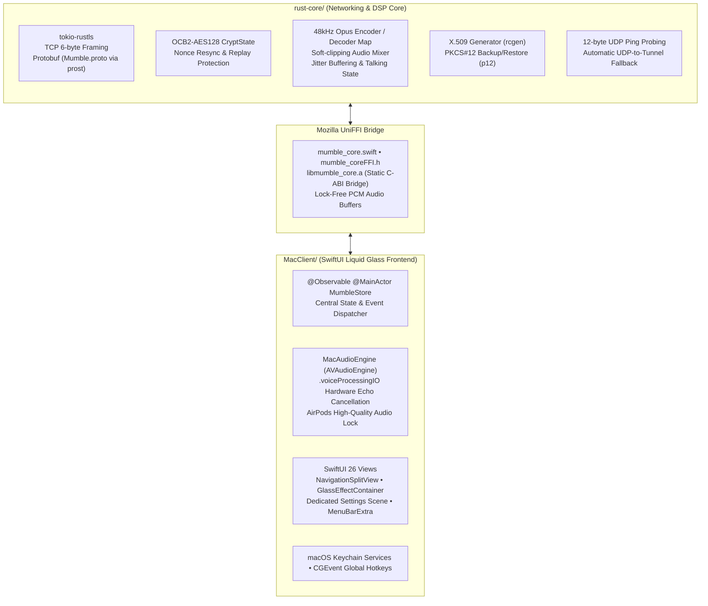

# Swimble

<p align="center">
  
</p>

<p align="center">
  <strong>The Next-Generation Native macOS Mumble VoIP Client</strong><br/>
  Powered by <strong>macOS 26 Liquid Glass SwiftUI</strong> and a high-performance <strong>Rust Core</strong>.
</p>

<p align="center">
  
  
  
  
  
  
  
</p>

---

## 🌟 Overview

**Swimble** is a modern, native macOS client for standard **Mumble (`Murmur`)** VoIP servers (TCP/TLS + UDP port 64738). 

Unlike legacy cross-platform Qt implementations, Swimble was built from the ground up specifically for macOS:
- **Zero Qt / C++ UI bloat**: Pure native SwiftUI embracing the **macOS 26 Liquid Glass** design language.
- **Ultra-Reliable Rust Engine**: All cryptographic networking, Protobuf framing, UDP OCB2-AES128 encryption, Opus encoding/decoding, and jitter buffering run in a thread-safe, memory-safe Rust core.
- **Studio-Grade Mac Audio**: Integrated with Apple `AVAudioEngine` and `.voiceProcessingIO` for hardware echo cancellation, low-latency render loops, and AirPods audio quality protection.
- **Strictly Standards-Compliant**: Fully interoperable with any standard Mumble 1.5 or 1.6 Murmur server without requiring custom plugins or server-side extensions.

---

## 🚀 Key Features

### 💎 macOS 26 Liquid Glass Aesthetics
- **Morphing Voice HUD**: Docked floating control bar wrapped in `GlassEffectContainer` with morphing capsule/circular controls (`.glassEffect(.regular.tint(...).interactive())`).
- **Dynamic Speaking Orbs**: Live glowing status orbs with instant visual differentiation:
  - 🟢 **Green** for normal channel voice
  - 🔷 **Cyan** for private or group whispers
  - 🟠 **Orange** for channel shouts
- **Accent Color Personalization**: Personalize your client's Liquid Glass highlights across Cyan, Emerald Green, Sapphire Blue, Amethyst Purple, Amber Orange, or Ruby Red.
- **Fluid Spring Animations**: Smooth layout morphing between VAD (Voice Activity Detection) and PTT modes.

### ⚙️ Dedicated macOS Settings Window (`Cmd + ,`)
A native, multi-tab macOS Settings window with instant live synchronization:
1. **General**: Startup auto-connect to favorite servers, customizable `NSSound` audio feedback chimes (Mute, Deafen, User Connect, Whisper, Chat), and Liquid Glass accent picker.
2. **Audio**: CoreAudio input & output device pickers, live microphone dB level meter with a draggable VAD threshold gate, local **Loopback Mic Test**, and **AirPods High-Quality Audio Lock**.
3. **Shortcuts**: Global background Push-to-Talk (PTT), Push-to-Whisper, and Mute/Deafen keybind recorders with live macOS Accessibility permission monitoring.
4. **Access Tokens**: Manage and sync channel password tokens with Murmur server ACLs.
5. **Certificates**: View your SHA-256 certificate fingerprint, export/import password-protected PKCS#12 (`.p12`) backup files, or generate fresh X.509 client identities.

### 🎙️ Audio Pipeline & Gamer Utilities
- **48 kHz Mono Opus VoIP**: 10ms frame intervals (480 samples/frame) with automatic soft-clipping and individual volume scaling ($0\%$ to $200\%$).
- **AirPods / Bluetooth Audio Lock**: Automatically locks input to the Mac's built-in microphone when Bluetooth output devices are active, preventing macOS from degrading stereo game audio into 16kHz Hands-Free mono.
- **Full-Screen Game Overlay**: Always-on-top compact Liquid Glass "Who's Talking" pill window (`NSWindow.Level.floating`) for full-screen games.
- **Menu Bar Companion (`MenuBarExtra`)**: Quick one-click microphone muting, deafening, and channel monitoring directly from the macOS menu bar.

### 📡 Classic Mumble Protocol & Server Management
- **Whisper & Shout (`VoiceTarget` Type 19)**: Direct 1-on-1 whispers to users, whispers to channels, or shouts to subchannel trees with dedicated hotkeys.
- **Connection Information Popover**: Click the toolbar ping pill for real-time diagnostics: Server Version, Server OS, TLS Cipher Suite, Audio Bandwidth (kbps), UDP vs. TCP Tunnel status, and Good / Late / Lost / Resync packet loss counters.
- **Channel Tree Management**:
  - Live `.searchable` fuzzy filtering for channels and users.
  - Double-click or click the header's **"Join Channel"** button to jump into a voice stream.
  - Create permanent or temporary sub-channels with descriptions and custom positions.
  - Drag-and-drop users between channels (`.dropDestination`).
- **User Administration**:
  - Register on server (`user_id = 0`) to claim and lock your username to your client certificate.
  - Set user comments with visual note badges.
  - Admin actions: Priority Speaker, Server Mute, Server Deafen, Move, Kick, and Ban.
- **Server Bookmarks Browser**:
  - Live 12-byte UDP ping latency probes (ms, active user counts, offline status).
  - Double-click any saved server to connect immediately.
  - Duplicate, favorite, or manage passwords securely backed by the **macOS Keychain**.

---

## 🏛️ Architecture & System Design

Swimble enforces a strict architectural boundary between native systems programming in Rust and modern UI/UX in Swift:



| Component | Technology | Responsibility |
| :--- | :--- | :--- |
| **Rust Core** | `rust-core/` | Handles all Mumble networking, TLS 1.3, UDP OCB2 encryption, Opus encoding/decoding, packet framing, PKCS#12 import/export, and server pinging. |
| **Bridge** | Mozilla `uniffi` | Generates safe, high-performance Swift bindings and C-ABI headers from Rust proc-macros. |
| **Swift Client** | `MacClient/` | Native macOS UI with SwiftUI Liquid Glass, CoreAudio device routing, global event taps (`CGEvent`), and Keychain credential storage. |

---

## 🛠️ Prerequisites

Ensure the following tools are installed on your Mac:

- **macOS 15.0+** (macOS 26 recommended for native Liquid Glass rendering)
- **Xcode 16+** (with Command Line Tools: `xcode-select --install`)
- **Rust Toolchain**: Stable Rust 1.80+ (`curl --proto '=https' --tlsv1.2 -sSf https://sh.rustup.rs | sh`)
- **Homebrew Dependencies**:
  ```bash
  brew install opus xcodegen
  ```
- **Docker** *(optional, for running a local Murmur server)*:
  ```bash
  docker pull mumblevoip/mumble-server:latest
  ```

---

## 📦 Building from Source

### 1. Build the Rust Core & UniFFI Bridge
Run the automated bridge build script. This compiles `rust-core` in release mode, generates the Swift UniFFI bindings, copies the static library, and generates the Xcode project:

```bash
./scripts/build_bridge.sh
```

### 2. Build the macOS Application
Build the Release application bundle from the terminal:

```bash
xcodebuild -project MacClient/Swimble.xcodeproj \
           -scheme Swimble \
           -destination 'platform=macOS' \
           -configuration Release build
```

The compiled application bundle will be located at:
```bash
build/Swimble.app
```

Launch the app:
```bash
open build/Swimble.app
```

> [!NOTE]
> **Xcode Project Management Rule**: Never edit `.pbxproj` directly. All Xcode project configurations are declared in [`MacClient/project.yml`](file:///Users/jurekzsl/Documents/code/Swimble/MacClient/project.yml). To regenerate the Xcode project at any time, run `xcodegen generate` inside `MacClient/`.

---

## 🧪 Local Testing & Verification

A standard Murmur server can be run locally in Docker for integration testing:

```bash
# Run local Murmur server
docker run -d --name murmur-test -p 64738:64738 -p 64738:64738/udp mumblevoip/mumble-server:latest
```

### Run Rust Unit & Integration Tests
Execute all Rust protocol tests, cryptographic roundtrips, and live Murmur integration tests:

```bash
cd rust-core
cargo test
```

All 8 unit tests (OCB2 encryption, replay validation, VarInt encoding, voice packet serialization, PKCS#12 export/import) and the live Murmur integration test will execute:

```text
running 8 tests
test voice_packet::tests::test_client_voice_packet_roundtrip ... ok
test voice_packet::tests::test_udp_ping_roundtrip ... ok
test voice_packet::tests::test_varint_roundtrip ... ok
test crypt_ocb2::tests::test_ocb2_replay_fails ... ok
test crypt_ocb2::tests::test_ocb2_tampered_tag_fails ... ok
test crypt_ocb2::tests::test_ocb2_encrypt_decrypt_roundtrip ... ok
test cert::tests::test_pkcs12_empty_password_roundtrip ... ok
test cert::tests::test_pkcs12_export_import_roundtrip ... ok

test result: ok. 8 passed; 0 failed; finished in 0.10s

running 1 test
test test_murmur_live_integration ... ok

test result: ok. 1 passed; 0 failed; finished in 0.43s
```

---

## ⌨️ Keyboard Shortcuts Cheatsheet

| Shortcut | Action | Scope |
| :--- | :--- | :--- |
| `Cmd + ,` | Open Dedicated Settings Window | Global App |
| `Cmd + Shift + M` | Toggle Microphone Mute | Global (In-App & Menu Bar) |
| `Cmd + Shift + D` | Toggle Audio Deafen | Global (In-App & Menu Bar) |
| `Cmd + Shift + O` | Toggle "Who's Talking" Game Overlay | Global (In-App & Menu Bar) |
| `~` *(Tilde / Custom)* | Push-to-Talk (Hold to Speak) | Global Background (Games) |
| `\` *(Backslash / Custom)* | Push-to-Whisper (Hold to Whisper) | Global Background (Games) |
| `Return` | Send Chat Message & Retain Focus | Chat View |
| `Double Click` | Join Channel / Quick Connect Bookmark | Channel Sidebar & Server Sheet |

---

## 📁 Repository Structure

```text
Swimble/
├── MacClient/                  # Native macOS SwiftUI Liquid Glass Client
│   ├── project.yml             # XcodeGen project specification (source of truth)
│   ├── Swimble.xcodeproj       # Generated Xcode project
│   ├── Generated/              # UniFFI generated bindings & libmumble_core.a
│   └── Sources/
│       ├── App.swift           # Application entry, WindowGroup, Settings, MenuBarExtra
│       ├── KeychainHelper.swift# macOS Keychain persistence for certs & passwords
│       ├── Audio/              # CoreAudio device manager, MacAudioEngine, GlobalPTT, SoundManager
│       ├── Models/             # ServerBookmark, ChannelTreeNode
│       ├── Store/              # MumbleStore (@Observable app state)
│       └── Views/              # Liquid Glass split view, sidebar, HUD, chat, settings tabs, overlay
├── rust-core/                  # Rust Networking & DSP Core
│   ├── Cargo.toml              # Rust dependencies (tokio, prost, rcgen, p12, etc.)
│   ├── proto/Mumble.proto      # Official Mumble Protobuf specification
│   ├── src/
│   │   ├── client.rs           # MumbleClient coordinator & UniFFI bridge exports
│   │   ├── connection.rs       # TLS connection, TCP/UDP framing, UDPTunnel fallback
│   │   ├── crypt_ocb2.rs       # Mumble OCB2-AES128 packet crypto & replay window
│   │   ├── voice_packet.rs     # VarInt encoding/decoding & Opus packet serialization
│   │   ├── audio_mixer.rs      # Multi-user Opus decoder map & soft-clipping mixer
│   │   ├── cert.rs             # X.509 cert generator & PKCS#12 (.p12) export/import
│   │   ├── ping.rs             # 12-byte UDP ping probe client
│   │   └── state.rs            # Thread-safe server state, permissions & stats
│   └── tests/                  # Integration tests against live Murmur Docker container
├── scripts/
│   └── build_bridge.sh         # Complete build & binding generation pipeline
└── build/
    └── Swimble.app             # Standalone compiled release application bundle
```

---

## 📄 License

Swimble is licensed under the **MIT License**. See [LICENSE](LICENSE) for details.

Mumble and Murmur are trademarks of the Mumble Project. Swimble is an independent open-source project.
