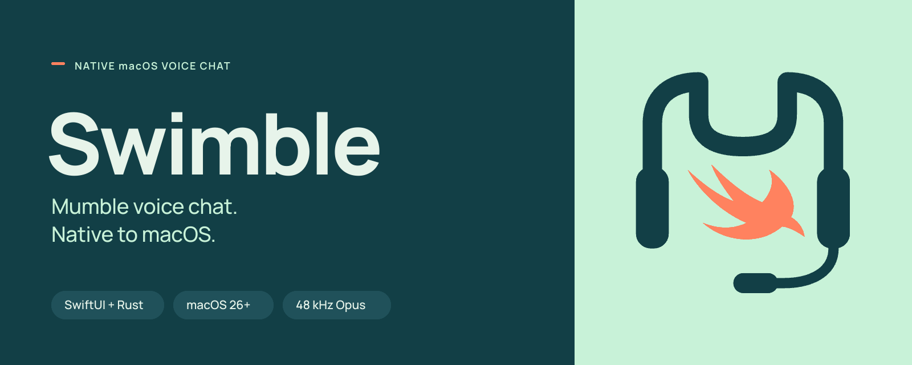

<p align="center">
  
</p>

**Swimble** is a native macOS client for standard Mumble voice servers. SwiftUI provides the interface and audio hardware integration; Rust implements the Mumble protocol, encrypted voice transport, Opus processing, and playback buffering.

[Download](https://github.com/jurek-zsl/Swimble/releases/latest) · [Screenshots & Video](MEDIA.md) · [Release history](https://github.com/jurek-zsl/Swimble/releases) · [Report an issue](https://github.com/jurek-zsl/Swimble/issues) · [Contributor to-do list](#contributing-and-to-do-list)

## Requirements and installation

- Apple Silicon or Intel Mac running macOS 26 or later. Release builds are universal.
- A standard Murmur server. No server extensions are required.
- Microphone permission for capture; Accessibility permission for global shortcuts.

Download the DMG, open it, and drag **Swimble** to **Applications**. The installer includes Opus, its license, a background image, and an Applications shortcut. Homebrew is not required to run the application.

Published builds currently use ad hoc signing and are not Apple-notarized. Each release includes a SHA-256 checksum. The packaging pipeline supports Developer ID signing and notarization when the maintainer's signing credentials are available; see [release instructions](scripts/RELEASING.md).

## Capabilities

| Area | Support |
| --- | --- |
| Voice | 48 kHz Opus capture, stereo playback, push-to-talk, voice activation, continuous transmission, mute/deafen, priority speakers, per-user volume, and whispers. |
| Voice quality | Configurable 6–128 kbit/s encoder target, 10/20/40/60 ms packets, server bandwidth budgeting, optional Opus FEC, sequence-aware reordering, loss concealment, and adaptive receive buffering. |
| Channels | Hierarchical navigation, listening without joining, channel links, creation/removal, names, hierarchy, ordering, user limits, descriptions, and ACL/group editing subject to server permissions. |
| Messaging | Channel/private messages, formatted descriptions and comments, inline images, per-user text ignore, TTS, notifications, bounded in-memory history, and unread indicators. |
| Audio hardware | App-scoped device routing by stable device UID, offline microphone preview, an output test tone, local/server loopback, VoiceProcessingIO echo cancellation, speech-driven system ducking, and Bluetooth input protection. |
| Positioning | Native Mumble Link, stereo virtual seating, manual world coordinates, distance/volume controls, native positional-plugin loading, and source diagnostics. |
| Recording | Synchronized 48 kHz stereo WAV: microphone on the left only while transmitting, received mix on the right. Each server window owns its recording. |
| Connections | Bookmarks, public directory, DNS SRV, IPv4/IPv6 endpoints, `mumble://` links, automatic TCP fallback, forced TCP mode, and reconnect backoff. |
| Identities | Client certificate generation and PKCS#12 import/export, certificate-based friends/local nicknames, system TLS trust, and explicit private-server fingerprint approval. |
| macOS | Liquid Glass interface, menu bar controls, trackpad haptics, speaker overlay, global keyboard/mouse shortcuts, named whisper presets, and local command-line control. |

New installations have no default server. Startup connection is opt-in and uses the last successfully connected saved server. Existing bookmarks are preserved. Empty channels do not display a zero participant count.

## Security and identity

TLS verifies the requested hostname through the macOS trust store and validates handshake signatures. Private/self-signed certificates require explicit SHA-256 fingerprint approval. Approvals are scoped to the requested host and port; a changed certificate stops connection for review. Server Information can remove a saved approval.

Client private keys and saved passwords live in Keychain. Earlier JSON credential caches and password-bearing bookmarks are migrated only after successful Keychain writes. New bookmark serialization excludes passwords. Identity loading runs away from the main actor; Keychain failures do not silently generate a replacement identity.

UDP voice uses Mumble-compatible OCB2-AES128, including the upstream XEX* countermeasures and replay protection. Incoming control frames have a size limit and read deadlines. Malformed or out-of-range Mumble URL ports are rejected.

Murmur remains authoritative for permissions. Persistent user grants use registered user IDs associated with certificates, rather than temporary session IDs. Older Murmur 1.5 builds can send a stale suppression flag after restoring Speak; affected users may need to reconnect.

## Audio configuration

**Audio Input** contains transmission thresholds, hold times, encoder quality, packet duration, FEC, microphone gain, and device selection. **Audio Output** contains playback volume, receive buffering, positioning, ducking, and microphone tests. Selected devices affect Swimble's audio units, not the Mac's system defaults.

Capture/playback callbacks exchange PCM through bounded lock-free queues. Resampling, Opus, mixing, and recording run on a worker. Statistics calculate FFT data only while displayed. Counters distinguish capture overruns and playback underruns; unavailable signal measurements are identified explicitly rather than estimated as measured values.

Microphone recording follows the transmission gate, including configured hold times. Local monitoring stays out of the received-audio recording track.

Local loopback works without a server. Server loopback requires a connection, uses the standard Mumble loopback voice target, and follows the transmission gate. Use headphones for microphone tests.

Ducking uses Apple's speech-driven voice processing. With ducking disabled, VoiceProcessingIO can still apply Apple's minimum attenuation. Disabling echo cancellation as well selects unprocessed capture. Bluetooth protection selects the built-in microphone for Swimble when appropriate, preserving stereo headphone output.

## Positional audio and game plugins

Native Link reads the POSIX `/MumbleLink.<uid>` layout, including avatar position, camera orientation, context, and player identity. Matching game contexts receive stereo positioning based on direction and distance. Manual positioning uses the original Mumble manual-placement context prefix. Virtual seating provides stereo separation without game integration.

Audio Output exposes near/far distance, far-distance volume, near-field spread, manual coordinates/heading/context, and source diagnostics. This is stereo positional rendering, without head tracking or HRTF processing.

The plugin manager loads trusted native macOS legacy positional plugins and standalone positional plugins using Mumble API 1.2. General Mumble host API requests are not implemented and return an explicit error; plugins requiring those APIs cannot be used. Windows/Wine binaries and games that macOS does not permit a plugin to inspect are unsupported. Saved plugin paths are listed for explicit activation; they are not silently loaded at startup.

## Shortcuts and local control

Global shortcuts target the last focused Swimble server window. Closing that window releases held transmission state and selects another connected session. Keyboard and side-mouse bindings support PTT, mute/deafen, overlay visibility, push-to-mute, transmission latching, channel joins/listening, and named whisper presets. Channel actions and whisper presets are scoped to their server.

The app bundles a local CLI:

```sh
/Applications/Swimble.app/Contents/MacOS/swimble-rpc mute
/Applications/Swimble.app/Contents/MacOS/swimble-rpc toggledeaf
/Applications/Swimble.app/Contents/MacOS/swimble-rpc starttalking
/Applications/Swimble.app/Contents/MacOS/swimble-rpc stoptalking
/Applications/Swimble.app/Contents/MacOS/swimble-rpc join 12
```

Run `swimble-rpc --help` for the command vocabulary. The control socket is restricted to the current macOS user. A `queued` response acknowledges dispatch to the active session, not server acceptance of a permission-controlled operation.

## Compatibility

The protocol targets standard Mumble 1.5 and 1.6 Murmur servers, including 1.5+ protobuf voice packets and legacy voice fallback. Default control/voice port: TCP/TLS and UDP `64738`. Compatibility testing uses local Murmur fixtures; a target version is not a claim that every upstream client feature is implemented.

Public server browsing uses Mumist.eu with a Mumble.info fallback. Directory activity data depends on the source. Release builds include Apple Silicon and Intel slices. Legacy voice codecs, a general Mumble plugin host, and injected game overlays are not provided. The floating macOS overlay depends on the game's window/full-screen behavior.

## Contributing and to-do list

Contributions are welcome. The checklist below contains all **63 tasks** from the [Mumble/Murmur compatibility audit](TO-DO.md), grouped by area. Each task links to its evidence, affected files, and completion criteria. The audit compares Mumble/Murmur 1.5.939 and 1.6.1001 RC 2; universal-binary support merged afterward is already reflected in the backlog.

**Priorities:** P1 covers privacy, identity, audio correctness, and connection reliability; P2 covers compatibility, usability, and release quality; P3 covers optional parity. Items marked **Verify** need reproduction or test evidence before being treated as confirmed bugs. Optional features need a product decision before implementation.

To start, choose a task, check [existing issues](https://github.com/jurek-zsl/Swimble/issues) and [pull requests](https://github.com/jurek-zsl/Swimble/pulls), then open or comment on an issue with its task ID and proposed approach. Keep pull requests focused, include the relevant validation, and update both this checklist and the detailed backlog when a task is completed. Larger entries can be split into smaller fixes under the same task ID.

| Interested in | Possible starting point |
| --- | --- |
| Documentation | [REL-04: build prerequisites and verification limits](TO-DO.md#rel-04) |
| Test reliability | [TEST-05: local fixtures and meaningful assertions](TO-DO.md#test-05) |
| Rust networking | [NET-03: use the connected TCP peer for UDP](TO-DO.md#net-03) |
| Swift privacy controls | [SEC-02: enforce remote-image blocking](TO-DO.md#sec-02) |

For priority work, start with **SEC-01 → SEC-02 → SEC-03 → NET-01 → NET-02 → PRO-01 → AUD-01 → UX-01**. Follow [the architecture rules](AGENTS.md): Mumble networking and processing belong in Rust; native UI, Keychain, input, and hardware I/O belong in Swift. Rust FFI changes require regenerated UniFFI bindings. Edit `MacClient/project.yml` and regenerate with XcodeGen for project changes. Protocol changes need integration tests against a disposable local Murmur server.

### Privacy, credentials, and identity

- [ ] [SEC-01 · P1 · Bug — Isolate access tokens by server and move them to Keychain.](TO-DO.md#sec-01)
- [ ] [SEC-02 · P1 · Bug — Make “Block External Remote Images” enforceable.](TO-DO.md#sec-02)
- [ ] [SEC-03 · P1 · Bug — Treat corrupt stored identities as errors, not missing identities.](TO-DO.md#sec-03)
- [ ] [SEC-04 · P1 · Bug — Synchronize identity replacement across server windows.](TO-DO.md#sec-04)
- [ ] [SEC-05 · P2 · Improve — Validate PKCS#12 identities before installing them.](TO-DO.md#sec-05)
- [ ] [SEC-06 · P2 · Improve — Provide complete certificate inspection and backup recovery.](TO-DO.md#sec-06)
- [ ] [SEC-07 · P1 · Improve — Bound and sanitize untrusted rich content.](TO-DO.md#sec-07)

### Connection and Rust core reliability

- [ ] [NET-01 · P1 · Bug — Clear session-scoped state on server changes and reconnects.](TO-DO.md#net-01)
- [ ] [NET-02 · P1 · Verify — Make connection replacement cancel and isolate every old task/callback.](TO-DO.md#net-02)
- [ ] [NET-03 · P1 · Bug — Use the established TCP peer for UDP.](TO-DO.md#net-03)
- [ ] [NET-04 · P1 · Bug — Correct ping and packet-statistics reporting.](TO-DO.md#net-04)
- [ ] [NET-05 · P1 · Improve — Propagate connection and command errors explicitly.](TO-DO.md#net-05)
- [ ] [NET-06 · P1 · Improve — Couple writer failure and write deadlines to connection shutdown.](TO-DO.md#net-06)
- [ ] [NET-07 · P1 · Improve — Harden parsers and per-session resource limits.](TO-DO.md#net-07)
- [ ] [NET-08 · P2 · Verify — Complete real-network recovery behavior.](TO-DO.md#net-08)
- [ ] [NET-09 · P2 · Missing — Add proxy support if full connection parity is required.](TO-DO.md#net-09)

### Mumble/Murmur protocol and administration parity

- [ ] [PRO-01 · P1 · Bug — Honor server recording policy.](TO-DO.md#pro-01)
- [ ] [PRO-02 · P2 · Missing — Respect server HTML and text/image length limits.](TO-DO.md#pro-02)
- [ ] [PRO-03 · P2 · Missing — Handle SuggestConfig and codec negotiation.](TO-DO.md#pro-03)
- [ ] [PRO-04 · P2 · Missing — Add listener volume adjustment and restoration.](TO-DO.md#pro-04)
- [ ] [PRO-05 · P2 · Missing — Add QueryUsers name/ID resolution for ACL editing.](TO-DO.md#pro-05)
- [ ] [PRO-06 · P2 · Missing — Support standard server-provided context actions.](TO-DO.md#pro-06)
- [ ] [PRO-07 · P2 · Missing — Expose newer ban choices and existing-ban editing.](TO-DO.md#pro-07)
- [ ] [PRO-08 · P1 · Bug — Validate bans before sending and reconcile with the server.](TO-DO.md#pro-08)
- [ ] [PRO-09 · P2 · Missing — Finish user administration actions.](TO-DO.md#pro-09)
- [ ] [PRO-10 · P2 · Bug — Make permissions and operation results consistent across UI paths.](TO-DO.md#pro-10)
- [ ] [PRO-11 · P2 · Missing — Preserve full text-message addressing.](TO-DO.md#pro-11)
- [ ] [PRO-12 · P2 · Improve — Finish incremental state and blob semantics.](TO-DO.md#pro-12)
- [ ] [PRO-13 · P2 · Bug — Make diagnostics describe actual data.](TO-DO.md#pro-13)

### Audio, recording, positioning, and shortcuts

- [ ] [AUD-01 · P1 · Bug — Adapt packet duration as well as bitrate to bandwidth limits.](TO-DO.md#aud-01)
- [ ] [AUD-02 · P1 · Verify — Make jitter recovery robust to variable durations and stream gaps.](TO-DO.md#aud-02)
- [ ] [AUD-03 · P1 · Bug — Apply local mute/volume changes immediately to buffered audio.](TO-DO.md#aud-03)
- [ ] [AUD-04 · P1 · Verify — Define target transitions and competing transmission inputs.](TO-DO.md#aud-04)
- [ ] [AUD-05 · P1 · Bug — Detect actual user activity for idle actions.](TO-DO.md#aud-05)
- [ ] [AUD-06 · P1 · Improve — Support receive-only audio and explain hardware failures.](TO-DO.md#aud-06)
- [ ] [AUD-07 · P2 · Improve — Isolate recording/plugin work from the audio worker.](TO-DO.md#aud-07)
- [ ] [AUD-08 · P2 · Missing — Preserve stereo Opus sources where applicable.](TO-DO.md#aud-08)
- [ ] [AUD-09 · P2 · Improve — Finish audio calibration and recording UX.](TO-DO.md#aud-09)
- [ ] [AUD-10 · P2 · Verify — Validate positional/plugin lifecycle across games and windows.](TO-DO.md#aud-10)

### SwiftUI, messaging, preferences, and native behavior

- [ ] [UX-01 · P1 · Bug — Make TTS controls authoritative.](TO-DO.md#ux-01)
- [ ] [UX-02 · P2 · Bug — Make settings Apply/Cancel/Reset transactional and shared.](TO-DO.md#ux-02)
- [ ] [UX-03 · P2 · Bug — Share bookmark storage across windows and validate edits.](TO-DO.md#ux-03)
- [ ] [UX-04 · P2 · Missing — Persist local user preferences by certificate identity.](TO-DO.md#ux-04)
- [ ] [UX-05 · P2 · Improve — Give chat stable identity and explicit destinations.](TO-DO.md#ux-05)
- [ ] [UX-06 · P2 · Bug — Route typed events instead of inferring them from English text.](TO-DO.md#ux-06)
- [ ] [UX-07 · P2 · Bug — Isolate drag/drop and channel navigation by server.](TO-DO.md#ux-07)
- [ ] [UX-08 · P2 · Improve — Unify active-session ownership and window lifecycle.](TO-DO.md#ux-08)
- [ ] [UX-09 · P2 · Improve — Complete accessibility and responsive layouts.](TO-DO.md#ux-09)
- [ ] [UX-10 · P2 · Improve — Reduce repeated rendering and consolidate duplicate components.](TO-DO.md#ux-10)
- [ ] [UX-11 · P2 · Missing — Add localization and finish user-facing settings semantics.](TO-DO.md#ux-11)
- [ ] [UX-12 · P3 · Missing — Add LAN discovery and migration conveniences.](TO-DO.md#ux-12)

### Tests and continuous integration

- [ ] [TEST-01 · P1 · Verify — Restore the local Murmur fixture and rerun live suites.](TO-DO.md#test-01)
- [ ] [TEST-02 · P1 · Missing — Pin and test both supported server versions.](TO-DO.md#test-02)
- [ ] [TEST-03 · P1 · Missing — Test against the original Mumble client, not only another Swimble endpoint.](TO-DO.md#test-03)
- [ ] [TEST-04 · P1 · Missing — Add deterministic lifecycle, policy, and credential regressions.](TO-DO.md#test-04)
- [ ] [TEST-05 · P2 · Improve — Make tests hermetic and assertions meaningful.](TO-DO.md#test-05)
- [ ] [TEST-06 · P1 · Verify — Exercise real audio hardware and concurrent sessions.](TO-DO.md#test-06)
- [ ] [TEST-07 · P2 · Improve — Add formatting/lint and bridge freshness checks to CI.](TO-DO.md#test-07)

### Packaging, documentation, and optional parity decisions

- [ ] [REL-01 · P2 · Improve — Verify compatible universal Opus builds and development fallbacks.](TO-DO.md#rel-01)
- [ ] [REL-02 · P2 · Improve — Make signing/notarization a verified release gate when credentials are available.](TO-DO.md#rel-02)
- [ ] [REL-03 · P2 · Improve — Inventory and bundle third-party notices.](TO-DO.md#rel-03)
- [ ] [REL-04 · P2 · Improve — Document the build environment and audit limitations accurately.](TO-DO.md#rel-04)
- [ ] [REL-05 · P3 · Optional — Decide the remaining upstream feature boundaries explicitly.](TO-DO.md#rel-05)

## Build and test

Install Xcode with the macOS 26 SDK or later and Rust. The commands below install XcodeGen and Protobuf tooling, then build universal Opus and the Rust bridge before building the app:

```sh
brew install protobuf xcodegen
./scripts/check_versions.py
./scripts/build_opus.sh
./scripts/build_bridge.sh
xcodebuild -project MacClient/Swimble.xcodeproj -scheme Swimble -destination 'platform=macOS' build
```

Run the protocol and Swift regression suites:

```sh
# A disposable local Murmur fixture must be available on 127.0.0.1:64738.
cargo test --manifest-path rust-core/Cargo.toml -- --test-threads=1
./scripts/test_acl.sh
xcodebuild -project MacClient/Swimble.xcodeproj -scheme Swimble -destination 'platform=macOS' -parallel-testing-enabled NO test
```

`test_acl.sh` starts and removes a separate localhost-only admin fixture on port `64739`; it does not modify the primary server's ACLs. Live tests verify strict TLS rejection/explicit trust, voice transport, stereo/deafen behavior, forced TCP, recording duration, listeners, links, channel edits, and ACL enforcement. Unit tests cover malformed framing, URL/credential serialization, OCB2 protections, packet ordering, encoder budgets, positional data, plugin ABI compatibility, and transmission state. Hardware tests run only when microphone access is already authorized.

GitHub Actions runs protocol integration checks on Linux and Swift regression checks on macOS 26. Build the portable installer with:

```sh
./scripts/build_release.sh
```

## Architecture

| Component | Responsibility |
| --- | --- |
| `rust-core/` | Mumble networking and state, TLS/OCB2, Protobuf voice/control, Opus, resampling, buffering/mixing, positional sources, recording, and local control transport. |
| `MacClient/` | SwiftUI, CoreAudio/AVAudioEngine hardware I/O, Keychain integration, global shortcuts, notifications, and application preferences. |
| UniFFI | Commands, events, state snapshots, and generated Swift bindings. |
| Native PCM boundary | Bounded `rtrb` queues accessed through a small C ABI, avoiding array serialization on audio callbacks. |

Edit `MacClient/project.yml` and regenerate with XcodeGen; do not edit `.pbxproj` directly. Rust FFI changes require regenerating the bridge. Protocol definitions and imported plugin headers retain their upstream Mumble BSD license.

## License

Swimble is licensed under the [MIT License](LICENSE). Third-party components retain their respective licenses.
